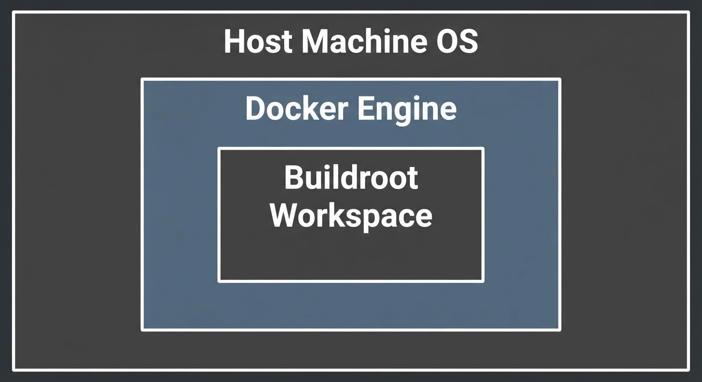
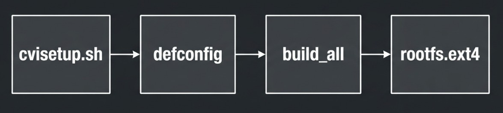
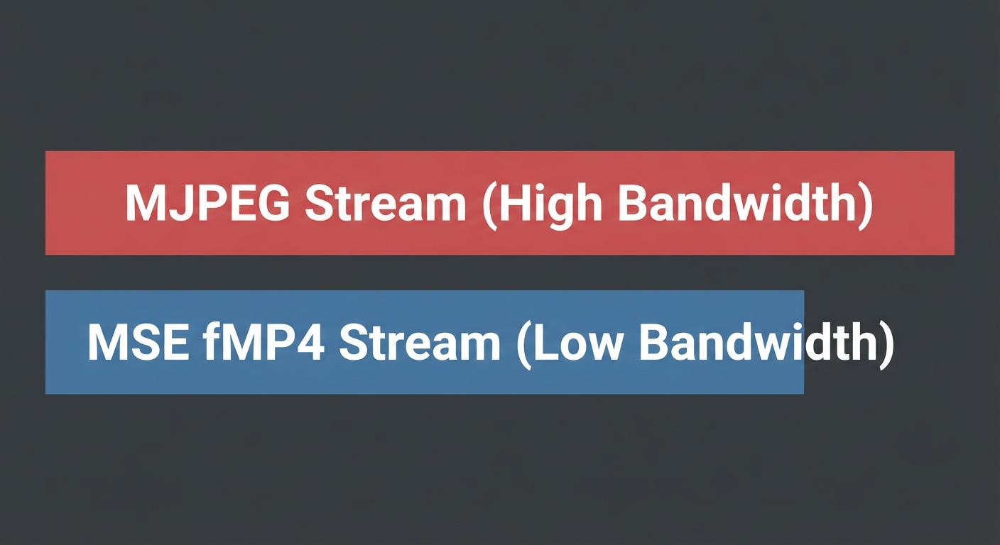
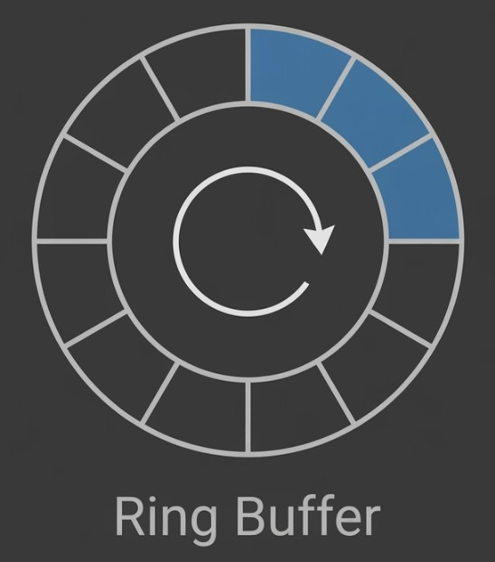
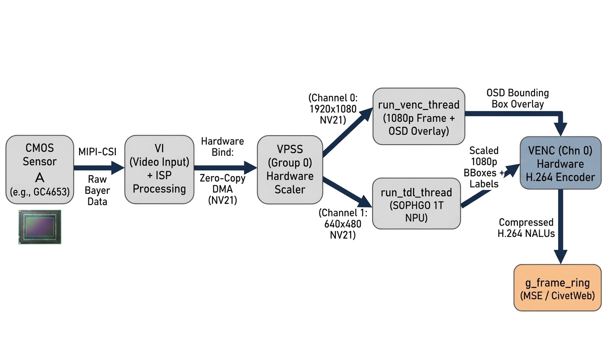

# LicheeRV Nano (SG2002) — Buildroot & Edge AI

**Undergraduate Thesis | Universidad Nacional de Colombia — Bogotá Campus**

*Implementation and Optimization of a YOLO Model on the LicheeRV Nano (SG2002) Embedded Platform for Object Detection with Replicable Documentation in Educational Environments.*

| Academic Information | Details | 
| ----- | ----- | 
| **Author** | Jesús Antonio López Trigozo | 
| **Institution** | Universidad Nacional de Colombia | 
| **Campus** | Bogotá | 
| **Faculty** | Faculty of Engineering | 
| **Advisor** | Carlos Iván Camargo Bareño | 
| **Status** | 🟢 Completed | 

---

## Table of Contents

- [01. Project Overview & Pedagogical Motivation](#01-project-overview--pedagogical-motivation)
  - [1.1. The Paradigm Shift: From Cloud AI to Edge AI](#11-the-paradigm-shift-from-cloud-ai-to-edge-ai)
  - [1.2. Project Objectives & Deliverables](#12-project-objectives--deliverables)
- [02. Hardware Platform & SoC Deep Dive](#02-hardware-platform--soc-deep-dive)
  - [2.1. LicheeRV Nano Form Factor & Physical Architecture](#21-licheerv-nano-form-factor--physical-architecture)
  - [2.2. SOPHGO SG2002 Heterogeneous Multi-Core Architecture](#22-sophgo-sg2002-heterogeneous-multi-core-architecture)
  - [2.3. Technical Specifications Matrix](#23-technical-specifications-matrix)
  - [2.4. Board Variants & Connectivity Matrix](#24-board-variants--connectivity-matrix)
  - [2.5. Hardware Revisions, Errata & Operational Precautions](#25-hardware-revisions-errata--operational-precautions)
  - [2.6. Hardware Diagrams & Visual References](#26-hardware-diagrams--visual-references)
- [03. Development Environment Setup](#03-development-environment-setup)
  - [3.1. Host Prerequisites & Docker Installation](#31-host-prerequisites--docker-installation)
  - [3.2. Clone the Build Environment](#32-clone-the-build-environment)
  - [3.3. Start the Docker Container](#33-start-the-docker-container)
  - [3.4. Cross-Compilation Toolchain Anatomy (`musl` vs. `glibc`)](#34-cross-compilation-toolchain-anatomy-musl-vs-glibc)
- [04. Base Dependencies & Software Setup](#04-base-dependencies--software-setup)
  - [4.1. Clone CVI TDL SDK](#41-clone-cvi-tdl-sdk)
  - [4.2. Clone CivetWeb Repository](#42-clone-civetweb-repository)
- [05. System Compilation & Application Build](#05-system-compilation--application-build)
  - [5.1. Configure Buildroot Environment](#51-configure-buildroot-environment)
  - [5.2. Build Base System Image (`build_all`)](#52-build-base-system-image-build_all)
  - [5.3. Cross-Compile and Install CivetWeb Library](#53-cross-compile-and-install-civetweb-library)
  - [5.4. Deploy Application & Helper Scripts](#54-deploy-application--helper-scripts)
  - [5.5. Download YOLOv8 CVIMODEL Repository](#55-download-yolov8-cvimodel-repository)
  - [5.6. Anatomy of the Build System (`Makefile` Breakdown)](#56-anatomy-of-the-build-system-makefile-breakdown)
- [06. System Image Deployment & Target Execution](#06-system-image-deployment--target-execution)
  - [6.1. Host Dependency Collection (`collect_libraries.sh`)](#61-host-dependency-collection-collect_librariessh)
  - [6.2. Flash Image, Stage Assets & Automated Wi-Fi Setup (`flash_sd.sh`)](#62-flash-image-stage-assets--automated-wi-fi-setup-flash_sdsh)
  - [6.3. Identify the Board on the Network](#63-identify-the-board-on-the-network)
  - [6.4. Connect Through SSH](#64-connect-through-ssh)
  - [6.5. Run Streaming Application](#65-run-streaming-application)
- [07. Current Development Scope & Educational Reproducibility](#07-current-development-scope--educational-reproducibility)
- [08. Software Architecture & Thermal/Performance Optimization](#08-software-architecture--thermalperformance-optimization)
  - [8.1. Source File Responsibilities](#81-source-file-responsibilities)
  - [8.2. Core Optimization Strategies for Low CPU Usage](#82-core-optimization-strategies-for-low-cpu-usage)
  - [8.3. Deep Dive: Technical Justifications & Code Philosophy](#83-deep-dive-technical-justifications--code-philosophy)
  - [8.4. Hardware Multimedia Pipeline Mechanics (`VI` $\rightarrow$ `VPSS` $\rightarrow$ `VENC`/`TDL`)](#84-hardware-multimedia-pipeline-mechanics-vi--vpss--venctdl)
  - [8.5. Memory Budget & ION/VB Pool Engineering in 256 MB DDR3](#85-memory-budget--ionvb-pool-engineering-in-256-mb-ddr3)
  - [8.6. Quantization & NPU Execution Mechanics (`INT8` & `.cvimodel`)](#86-quantization--npu-execution-mechanics-int8--cvimodel)
  - [8.7. ISO/IEC 14496-12 Bitstream Packaging & Frontend MSE Engine](#87-isoiec-14496-12-bitstream-packaging--frontend-mse-engine)
- [09. Troubleshooting, Diagnostics & Field Guide](#09-troubleshooting-diagnostics--field-guide)
- [10. References & Repositories](#10-references--repositories)

---

## 01. Project Overview & Pedagogical Motivation

This project focuses on preparing a customized embedded Linux environment for **YOLO-based object detection** on the LicheeRV Nano, powered by the SOPHGO SG2002 System-on-Chip (SoC).

The current work covers system configuration, embedded Linux image compilation, cross-compilation toolchains, network connectivity, hardware multimedia pipeline binding, and the low-level C software environment required for real-time AI deployment on severely resource-constrained hardware.

### 1.1. The Paradigm Shift: From Cloud AI to Edge AI

Traditionally, real-time computer vision pipelines rely on streaming raw or lightly compressed video feeds from low-cost edge sensors to centralized cloud servers or high-power workstation GPUs. While computationally convenient, this cloud-centric model introduces critical bottlenecks:
1. **Network Latency & Bandwidth Saturation:** Transmitting high-definition video continuously consumes substantial network throughput and introduces round-trip delays unsuitable for real-time control loops.
2. **Privacy & Data Sovereignty:** Raw video streams leaving local premises expose sensitive visual telemetry to external networks.
3. **Infrastructure Cost & Power Consumption:** Maintaining continuous cloud GPU instances and high-bandwidth uplinks scales poorly in academic laboratories and industrial deployments.

**Edge AI** inverts this paradigm by executing deep neural network (DNN) inference directly on silicon adjacent to the image sensor. By leveraging a dedicated **Neural Processing Unit (NPU)** integrated within a low-power SoC, the system processes raw sensor frames locally, extracts high-level semantic metadata (bounding boxes, class probabilities), overlays visual annotations in hardware/memory, and transmits only an ultra-efficient, hardware-compressed H.264 stream over the local network.

### 1.2. Project Objectives & Deliverables

**Project objectives**

- Customize and compile a Buildroot-based Linux image tailored for the RISC-V C906 architecture.
- Reduce unnecessary software, background daemons, and system memory overhead to maximize available RAM for the multimedia subsystem.
- Configure deterministic network connectivity (Ethernet/Wi-Fi 6) and headless remote access via SSH.
- Prepare and cross-compile against the **CVI TDL (Turnkey Deep Learning) SDK** for hardware-accelerated application development.
- Integrate **CivetWeb** as a statically linked, lightweight embedded HTTP server for low-latency Media Source Extensions (MSE) video streaming.
- Document the complete hardware, kernel, middleware, and application workflow as a reproducible, textbook-grade reference for students and researchers in educational environments.


---

## 02. Hardware Platform & SoC Deep Dive

### 2.1. LicheeRV Nano Form Factor & Physical Architecture

The **LicheeRV Nano**, engineered by Sipeed, is an ultra-compact System-on-Module (SoM) and development board measuring just **$22.86\text{ mm} \times 35.56\text{ mm}$** (roughly the size of a postage stamp or a standard DIP-28 integrated circuit). Despite its miniature footprint, it exposes an extensive set of industrial and multimedia interfaces—including MIPI-CSI, MIPI-DSI, SDIO, Ethernet MAC/PHY, USB 2.0 OTG, SPI, UART, $I^2C$, and PWM.

Its PCB edge features a **castellated half-hole / through-hole hybrid design** with standard $2.54\text{ mm}$ ($100\text{ mil}$) pitch headers spaced $800\text{ mil}$ apart. This dual-purpose mechanical engineering allows students to plug the board directly into standard solderless breadboards for rapid academic prototyping, while simultaneously enabling surface-mount reflow soldering onto custom carrier PCBs for mass production.

### 2.2. SOPHGO SG2002 Heterogeneous Multi-Core Architecture

At the heart of the LicheeRV Nano lies the **SOPHGO SG2002** (architecturally aligned with the CV181x family), a highly integrated, heterogeneous multi-core SoC designed specifically for smart IP cameras, edge vision terminals, and AIoT nodes:

1. **Primary Application Core (`1.0 GHz` Selectable RISC-V / ARM):**
   - Features a **T-Head XuanTie C906** 64-bit RISC-V core supporting the `RV64IMAFDCV` instruction set architecture (ISA), including the **RISC-V Vector Extension (`RVV 0.7.1`)** and hardware floating-point units (`F`/`D`).
   - Uniquely, the SG2002 silicon also includes an **ARM Cortex-A53** core on the die; the active primary core is selected at boot time via hardware strapping pins/eFuse configuration (defaulting to the 1 GHz RISC-V C906 on the LicheeRV Nano).
   - This core runs the Buildroot Linux kernel, manages the TCP/IP network stack, executes the CivetWeb HTTP server, and orchestrates SDK API calls.
2. **Secondary Real-Time Core (`700 MHz` RISC-V C906):**
   - A dedicated auxiliary 64-bit RISC-V C906 core intended to run a Real-Time Operating System (RTOS, such as FreeRTOS or AliOS Things) concurrently alongside Linux.
   - This Asymmetric Multi-Processing (AMP) capability allows deterministic, sub-millisecond control of motors, sensors, or audio codecs without interference from Linux kernel scheduling jitter.
3. **Ultra-Low-Power Auxiliary Core (`25–300 MHz` Intel 8051):**
   - Embedded inside the Always-On (AON) power domain, this classic 8-bit MCU manages deep-sleep wake-up triggers, RTC alarms, infrared LED illumination control, and battery power management while the main 1 GHz cores are completely powered down.
4. **Integrated Neural Processing Unit (`1.0 TOPS` NPU):**
   - A dedicated matrix-multiplication and convolution engine capable of delivering **$1.0\text{ TOPS}$ (Tera Operations Per Second)** at **INT8** precision, with native hardware support for **BF16 (Brain Floating Point 16)** for layers sensitive to quantization noise.
   - Coupled directly to the internal memory bus, the NPU executes quantized convolutional neural networks (such as YOLOv5, YOLOv8, MobileNet, and RetinaFace) completely independently of the main RISC-V CPU.
5. **Hardware Image Signal Processor (ISP) & Video Codec Engine:**
   - **ISP:** Performs real-time Bayer-to-YUV demosaicing, Auto Exposure (AE), Auto White Balance (AWB), Auto Focus (AF), 3D Noise Reduction (3DNR), and Wide Dynamic Range (WDR) processing directly on raw sensor data.
   - **VPU (Video Processing Unit):** Dedicated hardware ASIC encoders supporting **H.264 (AVC)** and **H.265 (HEVC)** up to $5\text{ MP}$ ($2880 \times 1620$) at $30\text{ FPS}$, alongside hardware JPEG encoding/decoding.

### 2.3. Technical Specifications Matrix

| Component | Specification | Technical Details & Notes |
|---|---|---|
| **SoC** | SOPHGO SG2002 | 22nm process, heterogeneous RISC-V/ARM + NPU architecture |
| **Main Core** | 1 GHz RISC-V C906 / ARM Cortex-A53 | Selectable via boot configuration; RV64GC + Vector (`xthead`) |
| **Secondary Core** | 700 MHz RISC-V C906 | Dedicated AMP core for RTOS / deterministic real-time tasks |
| **Low-Power Core** | 8051 MCU ($25\text{–}300\text{ MHz}$) | Resides in Always-On (AON) domain for standby wake-up control |
| **System Memory** | $2\text{ Gbit}$ ($256\text{ MB}$) DDR3 | Integrated SiP (System-in-Package) RAM shared between Linux OS and ION/VB pools |
| **AI Accelerator** | Integrated NPU — $1\text{ TOPS}$ INT8 | Supports INT8 symmetric/asymmetric quantization and BF16 |
| **Storage** | TF (microSD) Card / SD NAND | Bootable from microSD slot; unpopulated SD NAND pads on bottom PCB |
| **Video Output** | 2-lane MIPI DSI ($31\text{-pin}$ FPC) | Supports capacitive touchscreens ($3\text{"}$, $4\text{"}$, $10.1\text{"}$ accessories) |
| **Camera Input** | 4-lane MIPI CSI ($22\text{-pin}$ FPC) | Supports dual-CSI sensor splitting (e.g., GC4653, OS04A10, IMX335) |
| **Audio Subsystem** | Onboard PA + Analog Silicon Mic | Class-D amplifier drives speakers $< 1\text{ W}$ directly; onboard MEMS mic |
| **Wired Network** | $100\text{ Mbps}$ Ethernet | Internal PHY exposed via expansion board / RJ45 jack on `E` and `WE` variants |
| **Wireless Network** | Dual-Band Wi-Fi 6 + BLE 5.4 | $2.4\text{ GHz} / 5.8\text{ GHz}$ onboard module + IPEX antenna connector on `W` and `WE` |
| **USB Interface** | $1 \times \text{USB } 2.0\text{ OTG Type-C}$ | Provides power ($5\text{ V}$), USB-NCM Ethernet gadget, ADB, and UART console |
| **Expansion I/O** | $2 \times 14\text{-pin}$, $2.54\text{ mm}$ headers | $800\text{ mil}$ spacing; exposes UART, $I^2C$, SPI, SDIO, ADC, PWM, and GPIOs |
| **Physical Controls** | $1 \times \text{RST}$ button + $1 \times \text{BOOT}$ button | `BOOT` forces USB/SD recovery flashing mode on power-up |
| **Status Indicators** | $1 \times \text{Power LED}$ + $1 \times \text{User LED}$ | User LED controllable via Linux `/sys/class/leds` subsystem |
| **Operating System** | Buildroot Linux / Debian | Custom minimal Buildroot (`musl` libc) used in this thesis for minimal footprint |
| **Board Dimensions** | $22.86\text{ mm} \times 35.56\text{ mm}$ | Ultra-compact castellated module suitable for embedded integration |

### 2.4. Board Variants & Connectivity Matrix

Sipeed manufactures four hardware SKUs of the LicheeRV Nano to match different cost and connectivity requirements. All variants share the exact same SG2002 SoC, $256\text{ MB}$ DDR3 memory, onboard microphone, and speaker amplifier:

| Variant | Base System + Mic/Speaker | $100\text{ Mbps}$ Ethernet | Dual-Band Wi-Fi 6 | Bluetooth 5.4 | Recommended Use Case |
|---|---|---|---|---|---|
| **LicheeRV-Nano-B** | Yes | No | No | No | Offline edge inference, USB gadget mode, standalone screen kiosk |
| **LicheeRV-Nano-E** | Yes | Yes | No | No | Industrial PoE/wired IP cameras requiring deterministic link stability |
| **LicheeRV-Nano-W** | Yes | No | Yes | Yes | Wireless mobile robotics, drones, and untethered IoT vision nodes |
| **LicheeRV-Nano-WE** | Yes | Yes | Yes | Yes | **Target Thesis Platform:** Full development flexibility with wired fallback + Wi-Fi 6 |

### 2.5. Hardware Revisions, Errata & Operational Precautions

When replicating this project in an academic laboratory, engineers and students must observe the following hardware-specific precautions documented by Sipeed and SOPHGO:

1. **Beta Hardware Revision (`70405`) NPU Frequency Limit:**
   - Early engineering/beta batches of the LicheeRV Nano (marked with revision code `70405`) limit stable NPU operation to **$0.5\text{ TOPS}$** (half clock rate). Attempting to overdrive the NPU at full $1.0\text{ TOPS}$ on beta silicon may cause voltage droop, kernel panics, or inference corruption. Production boards support full $1.0\text{ TOPS}$ operation.
2. **Beta Hardware Wi-Fi Throughput Constraints:**
   - On beta revision `70405` boards, the SDIO Wi-Fi 6 driver calibration is unoptimized, resulting in lower peak throughput compared to production units. Using hardware-encoded H.264 over fMP4 (as implemented in this thesis) ensures smooth streaming even under constrained Wi-Fi bandwidth.
3. **Thermal Management & Heatsink Placement:**
   - Although the SG2002 is built on a power-efficient $22\text{ nm}$ node, simultaneous operation of the 1 GHz RISC-V core, ISP, H.264 VENC, NPU, and Wi-Fi 6 transceiver concentrates significant thermal flux into the compact $22.86 \times 35.56\text{ mm}$ PCB. Attaching a miniature aluminum heatsink with thermally conductive adhesive to the SG2002 package is strongly recommended during continuous 24/7 operation.
4. **Peripheral Assembly & Soldering Safety:**
   - When assembling the `WE` Ethernet daughterboard or mounting MIPI-CSI camera modules (such as the GC4653) using the supplied brass standoffs and screws, ensure power is completely disconnected. Never hot-plug the 22-pin MIPI-CSI or 31-pin MIPI-DSI ribbon cables while the board is energized, as this can permanently damage the SoC's high-speed differential PHY lanes.

### 2.6. Hardware Diagrams & Visual References

| Target Board & Camera Setup | Pinout Diagram |
|---|---|
|  |  |

| Board Variants & Physical Layout |
|---|
|  |

| SG2002 Subsystem Block Diagram | SG2002 System Architecture |
|---|---|
|  |  |

---

## 03. Development Environment Setup

Cross-compiling an entire embedded Linux distribution—including U-Boot, OpenSBI, the Linux 5.10 kernel, Buildroot root filesystem, and vendor multimedia middleware—requires a strictly controlled host environment. Subtle version mismatches in host compilers (`gcc`), `python3`, `cmake`, `bison`, or `flex` can break complex SDK build scripts. To guarantee 100% reproducibility across student workstations, the build environment uses **Docker** to isolate all host dependencies.

### 3.1. Host Prerequisites & Docker Installation

To avoid file-ownership and permission conflicts during root filesystem (`rootfs`) generation, device node creation (`mknod`), and container volume mounting, switch to superuser privileges (`root`) and navigate to its home directory before starting:

```bash
sudo su
cd /root
```

Update the host package index, install `curl`, and deploy the Docker Engine on the Ubuntu/Debian host system using the official convenience script:

```bash
apt update && apt install curl -y && curl -fsSL https://get.docker.com | sh
```

### 3.2. Clone the Build Environment

Run these commands on the **host machine** to download the official Sipeed SDK build system, fetch the SOPHGO RISC-V cross-compilation toolchains, and build the Ubuntu compilation container image:

```bash
git clone https://github.com/sipeed/LicheeRV-Nano-Build --depth=1
cd LicheeRV-Nano-Build
git clone https://github.com/sophgo/host-tools --depth=1
cd host/ubuntu
docker build -t licheervnano-build-ubuntu .
```

> **Note on `--depth=1`:** Using shallow clones drastically reduces download size and disk footprint by fetching only the latest commit snapshot rather than years of full Git revision history.

### 3.3. Start the Docker Container

Mount the local `/root/LicheeRV-Nano-Build/` directory into `/workspace` inside the container and launch an interactive Bash session:

```bash
docker run -v /root/LicheeRV-Nano-Build/:/workspace -it licheervnano-build-ubuntu /bin/bash
```

Because `/workspace` is bind-mounted directly to the host filesystem, all compiled binaries, kernel images, and custom C source files persist safely on the host machine even after the container exits.

### 3.4. Cross-Compilation Toolchain Anatomy (`musl` vs. `glibc`)

Inside `host-tools/gcc/`, SOPHGO provides multiple cross-compiler toolchains targeting different C standard libraries and architectures:
- **`riscv64-linux-musl-x86_64` (`musl` libc):** The primary toolchain used in this project (`SDK_VER=musl_riscv64`). `musl` is a lightweight, fast, standards-conformant C library designed specifically for embedded systems. Compared to `glibc`, `musl` produces significantly smaller static and dynamic binaries, consumes less RAM per thread stack, and avoids dynamic NSS (Name Service Switch) bloat.
- **`riscv64-linux-gnu-x86_64` (`glibc`):** Standard GNU C library toolchain, heavier in memory footprint, typically reserved for full Debian distributions.
- **Architectural Compiler Flags:** When compiling C code for the SG2002's XuanTie C906 core, the toolchain applies specific hardware target flags:
  ```text
  -mcpu=c906fdv -march=rv64imafdcv0p7xthead -mcmodel=medany -mabi=lp64d
  ```
  These flags instruct GCC to emit instructions utilizing the C906's double-precision hardware FPU (`fd`), vector engine (`v0p7`), and T-Head custom extensions (`xthead`), maximizing scalar execution efficiency.



---

## 04. Base Dependencies & Software Setup

Before compiling the operating system image or the custom streaming application, two external software repositories must be staged inside `/workspace`: the vendor AI inference SDK and the embedded HTTP web server library.

### 4.1. Clone CVI TDL SDK

Inside the container's `/workspace` directory, clone the **CVITEK Turnkey Deep Learning (TDL) SDK** tailored for the SG200x/CV181x family:

```bash
cd /workspace
git clone https://github.com/milkv-duo/cvitek-tdl-sdk-sg200x.git --depth=1
```

**What is the CVI TDL SDK?**
Programming the SOPHGO NPU directly at the register or raw tensor level (`cviruntime` / `cvikernel`) requires manually writing color-space conversion shaders, input tensor normalization routines, letterbox padding math, and complex post-processing decoders (such as Non-Maximum Suppression—NMS—for YOLO output tensors). The **CVI TDL SDK** wraps the low-level TPU runtime into a high-level C API (`cvi_tdl.h`, `cvi_tdl_app.h`) that provides:
- Hardware-accelerated preprocessing (`IVE` / `VPSS` scaling and mean/scale normalization).
- Native model runners for architectures like `CVI_TDL_SUPPORTED_MODEL_YOLOV8_DETECTION`.
- Hardware/software bounding-box and label rendering services (`CVI_TDL_Service_ObjectDrawRect`).

### 4.2. Clone CivetWeb Repository

Clone version `v1.15` of **CivetWeb** into the workspace directory:

```bash
cd /workspace
git clone --branch v1.15 --depth=1 https://github.com/civetweb/civetweb.git
```

**Why `v1.15`?** Version `1.15` provides a battle-tested, deterministic C89/C99 HTTP/1.1 core with full support for `Transfer-Encoding: chunked`, raw socket writes (`mg_write`), and multi-threaded connection pooling, without introducing breaking API changes or heavy external dependencies.

---

## 05. System Compilation & Application Build

Building the complete firmware and Edge AI application follows a strict two-stage dependency order: first generating the base Buildroot sysroot and kernel headers, and subsequently cross-compiling third-party libraries and our modular C application against that sysroot.

### 5.1. Configure Buildroot Environment

Execute the following commands **inside the container** to load the SOPHGO/Sipeed shell helper functions (`cvisetup.sh`), select the LicheeRV Nano microSD board configuration (`sg2002_licheervnano_sd`), and mark `/workspace` as a safe Git directory:

```bash
cd /workspace
source build/cvisetup.sh
defconfig sg2002_licheervnano_sd
git config --global --add safe.directory /workspace
```

### 5.2. Build Base System Image (`build_all`)

Trigger the primary base build process **before** placing custom application code:

```bash
cd /workspace
build_all
```

**What happens during `build_all`?**
1. **FSBL & OpenSBI Compilation:** Builds the First-Stage Bootloader (`fip.bin`) and the RISC-V Supervisor Binary Interface (`OpenSBI`), configuring DDR3 memory timings and CPU clock frequencies.
2. **U-Boot Compilation:** Compiles the secondary bootloader responsible for reading the boot partition on the microSD card and loading the kernel device tree (`sg2002_licheervnano_sd.dtb`).
3. **Linux 5.10 Kernel Compilation:** Compiles the RISC-V Linux kernel along with out-of-tree kernel modules (`ko`) for the SOPHGO multimedia subsystem (`cvi_base`, `cvi_sys`, `cvi_vb`, `cvi_vi`, `cvi_vpss`, `cvi_venc`, `cvi_tpu`), MIPI-CSI camera sensors, and the AIC8800 Wi-Fi 6 SDIO driver.
4. **Buildroot RootFS Generation:** Compiles BusyBox, Dropbear (SSH server), `wpa_supplicant`, system libraries, and populates the cross-compilation **sysroot** located at `/workspace/buildroot/output/host/riscv64-buildroot-linux-musl/sysroot`.



### 5.3. Cross-Compile and Install CivetWeb Library

Once the Buildroot `sysroot` exists, cross-compile CivetWeb as a static archive (`libcivetweb.a`) using the RISC-V `musl` GCC compiler and install both the static library and header file directly into the Buildroot sysroot:

```bash
cd /workspace/civetweb && make WITH_CPP=0 WITH_LUA=0 WITH_IPV6=1 COMS_CFLAGS="-O2" CC=/workspace/host-tools/gcc/riscv64-linux-musl-x86_64/bin/riscv64-unknown-linux-musl-gcc AR=/workspace/host-tools/gcc/riscv64-linux-musl-x86_64/bin/riscv64-unknown-linux-musl-ar lib && cp libcivetweb.a /workspace/buildroot/output/host/riscv64-buildroot-linux-musl/sysroot/usr/lib/ && cp include/civetweb.h /workspace/buildroot/output/host/riscv64-buildroot-linux-musl/sysroot/usr/include/
```

> **Compilation Flags Breakdown:**
> - `WITH_CPP=0`: Disables C++ wrappers to avoid linking `libstdc++`, saving ~1.5 MB of flash/RAM.
> - `WITH_LUA=0`: Strips embedded Lua scripting support to minimize attack surface and binary size.
> - `WITH_IPV6=1`: Enables dual-stack IPv4/IPv6 socket binding.
> - `COMS_CFLAGS="-O2"`: Enables Level 2 compiler optimizations for high HTTP throughput.

### 5.4. Deploy Application & Helper Scripts

Clone the thesis application repository, integrate the modular C source tree (`http_streamer_tdl`) into the middleware sample directory, stage the deployment scripts, and compile the binary:

```bash
git clone https://github.com/m0nkeyh4ck/licheerv-nano-sg2002-yolo-streaming /tmp/repo
mv /tmp/repo/http_streamer_tdl /workspace/middleware/v2/sample/
cp /tmp/repo/*.sh /workspace/ 2>/dev/null || true
rm -rf /tmp/repo
cd /workspace/middleware/v2/sample/http_streamer_tdl
make clean
make
```

### 5.5. Download YOLOv8 CVIMODEL Repository

Download the pre-compiled and INT8-quantized YOLOv8 `.cvimodel` weights compatible with the CV181x/SG2002 NPU architecture:

```bash
cd /workspace
git clone https://github.com/zwyzwm/YOLOv8-Object-Detection.git
```

### 5.6. Anatomy of the Build System (`Makefile` Breakdown)

Understanding how `http_streamer_tdl` links across four distinct software layers is essential for students modifying or extending the codebase. The custom `Makefile` orchestrates the following include and library hierarchies:

1. **Sysroot Headers First (`-I$(SYSROOT)/usr/include`):** Ensures that standard C headers (`pthread.h`, `stdio.h`, `stdlib.h`) and `civetweb.h` resolve against the target `musl` sysroot rather than the host x86_64 Ubuntu headers.
2. **Middleware & ISP Headers (`-I$(MW_INC_PATH)` & `-I$(MW_ISP_INC_PATH)`):** Links the SOPHGO Multimedia Framework (`MMF`) APIs for `SYS`, `VB`, `VI`, `VPSS`, `VENC`, and sensor-specific ISP tuning parameters (`-DCV181X`).
3. **TDL & TPU Headers (`-I$(TDL_INC_PATH)`):** Provides access to `cvitdl_handle_t`, `cvtdl_object_t`, and hardware bounding-box drawing routines.
4. **Linker Group Resolution (`-Wl,--start-group ... -Wl,--end-group`):** Embedded vendor libraries often contain circular symbol dependencies across `libsample`, `libsys`, `libisp`, `libcvi_tdl`, `libcviruntime`, and `libopencv_core`. Wrapping all static/shared archives inside `--start-group` and `--end-group` instructs the GNU linker (`ld`) to repeatedly scan the archive list until all undefined references are cleanly resolved.

---

## 06. System Image Deployment & Target Execution

With the Buildroot OS image, shared libraries, YOLOv8 `.cvimodel`, and `http_streamer_tdl` binary compiled, the final stage packages these artifacts onto a bootable microSD card and launches the Edge AI server on the LicheeRV Nano.

### 6.1. Host Dependency Collection (`collect_libraries.sh`)

Run the dependency collection script from your **host machine** (outside the Docker container):

```bash
cd /root/LicheeRV-Nano-Build
chmod +x collect_libraries.sh
./collect_libraries.sh
```

**Why is `collect_libraries.sh` necessary?**
While CivetWeb is statically linked into `http_streamer_tdl`, the vendor middleware (`libsys.so`, `libvpu.so`, `libvenc.so`, `libisp.so`), TDL SDK (`libcvi_tdl.so`), TPU runtime (`libcviruntime.so`, `libcvikernel.so`), and OpenCV (`libopencv_core.so`, `libopencv_imgproc.so`) are dynamically linked shared objects. `collect_libraries.sh` inspects the compiled ELF binary dependencies (`readelf -d`) and gathers every required `.so` library into a clean staging directory so they can be injected into `/mnt/system/lib` or `/usr/lib` on the target filesystem.

### 6.2. Flash Image, Stage Assets & Automated Wi-Fi Setup (`flash_sd.sh`)

Open and edit the deployment script on the host machine to configure your target microSD block device (e.g., `/dev/sdb` or `/dev/mmcblk0`) and your laboratory's Wi-Fi SSID/PSK credentials:

```bash
nano /root/LicheeRV-Nano-Build/flash_sd.sh
```

Make the script executable and run it to write the partition table, flash `boot.sd` and `rootfs.sd`, copy the `http_streamer_tdl` executable, copy `yolov8n_cv181x_int8_sym.cvimodel`, and pre-configure `wpa_supplicant.conf` for headless boot:

```bash
cd /root/LicheeRV-Nano-Build
chmod +x flash_sd.sh
./flash_sd.sh
```

> ⚠️ **CRITICAL SAFETY WARNING:** Double-check the target device path inside `flash_sd.sh` using `lsblk` before execution. Specifying the wrong block device (such as `/dev/sda` or `/dev/nvme0n1`) will overwrite your host workstation's primary hard drive!

### 6.3. Identify the Board on the Network

Insert the flashed microSD card into the LicheeRV Nano, attach the MIPI-CSI camera module, and power the board via the USB Type-C port. Once booted (~15–20 seconds), scan your local subnet for open SSH ports (port `22`) to discover the DHCP IP address assigned to the board:

```bash
sudo nmap -sV -p 22 192.168.1.0/24
```

*(Alternatively, if connected via USB-C to a Linux/Windows host, the board exposes a USB-NCM network interface typically reachable at `192.168.42.1`.)*

### 6.4. Connect Through SSH

Establish a headless terminal session to the LicheeRV Nano as `root`:

```bash
ssh root@<BOARD_IP_ADDRESS>
```

### 6.5. Run Streaming Application

Navigate to `/root` on the target board and launch `http_streamer_tdl`, passing the quantized YOLOv8 model path as the first command-line argument:

```bash
cd /root
./http_streamer_tdl yolov8n_cv181x_int8_sym.cvimodel
```

Once initialized, open any modern web browser (Chrome, Firefox, Edge, Safari) on a computer or smartphone connected to the same network and navigate to:

```text
http://<BOARD_IP_ADDRESS>:8080/
```

The browser will automatically negotiate an H.264 Media Source Extensions (MSE) stream and render real-time 1080p video overlaid with YOLOv8 bounding boxes, class names, and confidence scores.


---

## 07. Current Development Scope & Educational Reproducibility

This repository documents the complete end-to-end engineering lifecycle of an embedded Edge AI vision system on the SOPHGO SG2002 platform—spanning Dockerized build environments, Buildroot system generation, hardware multimedia pipeline programming (`VI`/`VPSS`/`VENC`), NPU quantization integration (`CVI_TDL`), and low-overhead network streaming (`CivetWeb` + `fMP4`/`MSE`).

From an **educational perspective**, this work bridges the gap between high-level Python deep learning tutorials (which abstract away hardware realities) and real-world embedded systems engineering. By decomposing the C application into clean, single-responsibility modules and documenting every architectural trade-off, students at the **Universidad Nacional de Colombia** and beyond can inspect, modify, benchmark, and extend every layer of the stack—from kernel memory pools up to browser JavaScript media buffers.

---

## 08. Software Architecture & Thermal/Performance Optimization

The streaming application (`http_streamer_tdl`) is engineered specifically for resource-constrained SoC environments (SOPHGO SG2002 / CV181X). High performance, stable FPS, low CPU utilization, and minimal thermal dissipation are achieved through strict C-level design pattern optimizations.

### 8.1. Source File Responsibilities

| System Architecture Flowchart |
|---|
|  |

| Module (`.c` / `.h`) | Primary Responsibility | Optimization Focus |
|---|---|---|
| `http_streamer_tdl` | Main entry point, signal handling (`SIGINT`/`SIGTERM`), SDK hardware binding, thread lifecycle. | Clean deterministic subsystem tear-down and memory release. |
| `sensor_config` | Sensor initialization (`sensor_cfg.ini` parsing) and dynamic format negotiation. | Dynamic resolution setup matching physical MIPI-CSI hardware capability. |
| `vb_pool` | Allocation of hardware Video Buffer (VB) pools in contiguous DDR memory. | Zero-copy ISP/VPSS hardware buffer reuse across channels. |
| `vi_init` | Video Input (VI) pipeline setup for raw MIPI-CSI sensor capture. | Direct hardware DMA streaming from sensor ISP to DDR memory. |
| `vpss_init` | Video Processing SubSystem configuration (scaling, cropping, pixel format conversion). | Dual-channel hardware scaling (1080p for stream, 640x480 for NPU). |
| `venc_handler` | H.264 encoding thread (`VENC`), NPU inference thread (`TDL`), and circular ring buffer. | Reusable memory ring buffer and hardware/canvas NPU label overlay. |
| `fmp4_init_segment` | ISO/IEC 14496-12 MP4 container box builder (`ftyp`, `moov`, `moof`, `mdat`). | In-memory fast NAL unit Annex-B to AVCC conversion without FFmpeg. |
| `mse_stream` | Media Source Extensions (MSE) HTTP chunked video streaming server handler. | Passive thread synchronization and static copy buffering. |
| `web_handler` | CivetWeb HTTP routes (`/`, `/stream`, `/mse_stream`, `/stats`), HTML/JS web player interface. | Network socket I/O decoupled from mutex lock scopes. |

---

### 8.2. Core Optimization Strategies for Low CPU Usage

#### 1. Hardware Pipeline Offloading (Zero-CPU Video/AI Pipeline)
Instead of processing frames in software via CPU routines (such as `cv::VideoCapture`, `cv::resize`, or software `libx264` encoding, which would immediately overwhelm a 1 GHz single-core RISC-V processor):
- **MIPI CSI Camera Capture (`VI`)** streams frames via Direct Memory Access (DMA) directly into hardware Video Buffer pools (`VB Pool`) after ISP demosaicing.
- **Video Process SubSystem (`VPSS`)** splits the single incoming sensor feed into two parallel hardware-accelerated streams: **Channel 0** maintains full 1080p (`1920x1080`) NV21 frames for high-definition encoding, while **Channel 1** downscales frames in dedicated silicon to `640x480` NV21 for NPU inference.
- **NPU Acceleration (`TPU / CVI_TDL`)** handles INT8 YOLOv8 convolutional and tensor operations on dedicated silicon, leaving the RISC-V host CPU idling during matrix multiplications.
- **Hardware Encoder (`VENC`)** compresses raw NV21 frames directly into H.264 High Profile bitstreams in real-time using dedicated ASIC hardware.


#### 2. Zero Per-Frame Heap Allocation (Persistent Dynamic Buffering)
Executing `malloc()` and `free()` inside 30 FPS high-frequency loops causes kernel heap fragmentation, `brk`/`mmap` system call overhead, TLB shootdowns, thermal throttling, and unpredictable CPU latency spikes.

To eliminate this, `venc_handler.c` and `mse_stream.c` utilize **persistent capacity-expanding buffers**. Buffers expand only when encountering larger frame sizes (such as complex I-frames) and retain their allocated heap capacity indefinitely across the lifetime of the process.

#### 3. Passive Thread Synchronization (`pthread_cond_t` vs Polling)
Polling loops with `usleep()` consume CPU cycles during sleep-wake context transitions and introduce artificial frame jitter. The streaming handlers utilize POSIX condition variables (`pthread_cond_timedwait`), putting consumer threads into a zero-CPU kernel sleep state until woken instantaneously by the producer thread.

#### 4. Mutex Decoupling from Network Socket I/O
Performing slow blocking socket writes (`mg_write`) inside critical section locks causes thread starvation and blocks video capture pipelines. In `web_handler.c` and `mse_stream.c`, frame data is copied locally inside a fast microsecond mutex lock, and the lock is **released immediately prior to network transmission**.

---

### 8.3. Deep Dive: Technical Justifications & Code Philosophy

This section serves as a comprehensive textbook-level explanation of **why** specific libraries, code structures, and paradigms were chosen over conventional alternatives. Developing for an embedded RISC-V SoC with 256MB of shared DDR memory requires abandoning standard desktop-level programming practices.

#### 8.3.1. The Justification for fMP4 and MSE over MJPEG or WebSockets
*Referencing: `fmp4_init_segment.c` and `mse_stream.c`*

In many embedded IP cameras, **MJPEG (Motion JPEG)** is the default streaming protocol because it is trivial to implement: the server simply takes an array of JPEG images and sends them over HTTP in a `multipart/x-mixed-replace` stream. 

**Why we rejected MJPEG:**
1. **Bandwidth Annihilation:** A 1080p JPEG image typically ranges between $200\text{ KB}$ and $500\text{ KB}$. At $30\text{ FPS}$, MJPEG requires between $48\text{ Mbps}$ and $120\text{ Mbps}$ of continuous network bandwidth. This saturates the LicheeRV Nano's SDIO Wi-Fi module immediately, causing severe packet loss, TCP retransmissions, and frame drops.
2. **Ignoring Temporal Redundancy:** MJPEG encodes every single frame as an independent intra-coded image, completely ignoring temporal redundancy (the fact that static backgrounds do not change between consecutive frames).

**Why we rejected WebSockets with Raw H.264:**
While we use the hardware `VENC` to generate H.264 NALUs (Network Abstraction Layer Units), sending raw NALUs over WebSockets requires the browser client to execute software decoders (such as Broadway.js or FFmpeg compiled to WebAssembly). Software decoding in JavaScript/WASM is heavily CPU-intensive for the viewing device, drains laptop/mobile batteries, and introduces multi-frame buffering latency.

**The Solution: Media Source Extensions (MSE) with fragmented MP4 (fMP4):**
By packing the raw H.264 NALUs into an ISO Base Media File Format (fMP4) container on the fly (`fmp4_init_segment.c`), we allow the receiving web browser to pass the stream directly to its **native OS/GPU hardware video decoder** via the standard HTML5 `<video>` element.
- **The Initialization Segment (`ftyp` + `moov`):** Generated dynamically when a client connects (`build_init_segment()`). It informs the browser's MSE `SourceBuffer` of the stream geometry ($1920 \times 1080$), timescale ($90,000\text{ Hz}$), and injects the exact H.264 **SPS (Sequence Parameter Set)** and **PPS (Picture Parameter Set)** NALUs inside the `avcC` decoder configuration box.
- **The Media Fragments (`moof` + `mdat`):** Each time the `VENC` thread produces a compressed frame, `build_fragment()` wraps the frame inside a Movie Fragment box (`moof`) containing precise decoding timestamps (`tfdt`) and sample flags (`trun` distinguishing keyframes `0x02000000` from delta frames `0x01010000`), followed immediately by the Media Data box (`mdat`).
- **Zero-Overhead Parsing:** We built a custom Annex-B to AVCC parser (`annexb_copy_cb`). Instead of linking massive multimedia frameworks like FFmpeg/libavformat (which would bloat our binary by tens of megabytes and consume precious RAM), we scan the 3-byte (`0x000001`) and 4-byte (`0x00000001`) Annex-B start codes using a raw pointer slide in C, strip out inline SPS/PPS headers, and prepend 4-byte big-endian NALU length prefixes (`AVCC` format).



#### 8.3.2. Dynamic Ring Buffer Architecture
*Referencing: `venc_handler.c` (`g_frame_ring`)*

The system must serve multiple concurrent HTTP clients viewing the live video feed simultaneously without duplicating frame storage per client in global memory.

**The naive approach (which we avoided):**
Allocating a fresh heap buffer `malloc(frame_size)` every time the hardware encoder generates a frame, appending it to a dynamic linked list, and reference-counting clients to call `free()` later. In a 256 MB embedded Linux system without swap space, rapid variable-sized allocations fragment the virtual address space and physical page allocator, eventually triggering the Linux **OOM (Out-of-Memory) killer** to terminate the application.

**Our Architecture: Pre-allocated Circular Ring Buffer**
We declare a fixed-size circular array of frame slots `g_frame_ring[BUFFER_SIZE]`:

```c
// Dynamic expansion logic in venc_handler.c
if (g_frame_ring[idx].capacity < total_size) {
    uint8_t *new_ptr = realloc(g_frame_ring[idx].data, total_size + 16384);
    // ...
}
```
- **Why `+ 16384`?** In H.264 video compression, **I-frames (IDR Keyframes)** contain full spatial image data and are typically $5\times$ to $15\times$ larger than **P-frames (Predicted frames)**. By adding a $16\text{ KB}$ ($16,384\text{ bytes}$) headroom padding during `realloc`, we ensure that subsequent I-frames fit cleanly into the existing buffer without triggering another `realloc` system call. Over the first few seconds of streaming, all ring buffer slots stabilize at the peak frame capacity, and `realloc` is **never invoked again** for the remainder of runtime. The RSS memory footprint remains completely flat.

<p align="center">
  
</p>

#### 8.3.3. Threading Synchronization: Mutex vs Spinlocks vs Condition Variables
*Referencing: `http_streamer_tdl.c` and `mse_stream.c`*

The streaming subsystem implements a multi-consumer Producer-Consumer concurrency model:
- **Single Producer:** `run_venc_thread` (Hardware encoder feeding compressed H.264 frames into `g_frame_ring`).
- **Multiple Consumers:** `handler_stream_mse` and `handler_stream` (CivetWeb worker threads serving connected HTTP clients).

**Why not Polling?**
```c
// BAD CODE EXAMPLE - REJECTED
while(!new_frame) {
    usleep(1000); // Sleeps for 1ms
}
```
`usleep` forces frequent kernel timer interrupts and voluntary context switches. Waking up each client thread $1,000$ times per second merely to check a shared boolean flag wastes CPU cycles, pollutes the L1/L2 instruction/data caches, and elevates SoC junction temperature.

**The implementation used: `pthread_cond_timedwait`**
```c
struct timespec ts;
clock_gettime(CLOCK_REALTIME, &ts);
ts.tv_nsec += 50000000; // 50ms timeout
if (ts.tv_nsec >= 1000000000) { ts.tv_sec += 1; ts.tv_nsec -= 1000000000; }
pthread_cond_timedwait(&g_frame_cond, &g_frame_lock, &ts);
```
1. The HTTP client thread acquires `g_frame_lock` and inspects whether `next != g_frame_write_idx`.
2. If no new frame has been produced yet, it calls `pthread_cond_timedwait`. The kernel **atomically unlocks `g_frame_lock` and transitions the thread into an interruptible sleep state**. CPU consumption for idle waiting threads drops to exactly $0\%$.
3. As soon as `run_venc_thread` finishes copying a new encoded frame into the ring buffer, it invokes `pthread_cond_broadcast(&g_frame_cond)`.
4. The kernel immediately wakes *all* waiting HTTP client threads, re-acquires the mutex sequentially, and dispatches the frame with sub-millisecond latency.
5. **Why `timedwait` instead of infinite `pthread_cond_wait`?** The $50\text{ ms}$ timeout acts as a deterministic dead-man's switch. If the MIPI-CSI camera is disconnected or the user presses `Ctrl+C` (`SIGINT`), every client thread is guaranteed to wake up within $50\text{ ms}$, evaluate `if (g_bExit) break;`, clean up its local buffers, and exit gracefully without deadlocking.


#### 8.3.4. Overcoming Network Head-of-Line Blocking
In embedded devices operating over shared Wi-Fi channels, wireless interference or client-side network congestion can cause TCP send buffers to fill up, stalling `send()`/`write()` socket calls for hundreds of milliseconds.

If we transmit data over the network socket *while* holding the global ring buffer mutex:
```c
// BAD PATTERN - CAUSES PIPELINE STALL
pthread_mutex_lock(&g_frame_lock);
mg_write(conn, data, size); // Blocks for 200ms if Wi-Fi is congested
pthread_mutex_unlock(&g_frame_lock);
```
While the network thread is stalled inside `mg_write`, the `run_venc_thread` producer cannot acquire `g_frame_lock` to store incoming hardware frames. The VENC output FIFO overflows, dropping frames across *all* clients and stalling the real-time pipeline.

**Our Lock-Free I/O Pattern:**
```c
// GOOD PATTERN (Implemented in mse_stream.c & web_handler.c)
pthread_mutex_lock(&g_frame_lock);
// 1. FAST MEMORY COPY (Microseconds)
memcpy(frame_copy, g_frame_ring[next].data, frame_size);
pthread_mutex_unlock(&g_frame_lock); // UNLOCK IMMEDIATELY BEFORE NETWORK I/O

// 2. SLOW NETWORK WRITE (Milliseconds)
send_chunk(conn, frag.data, frag.size);
```
By maintaining a persistent per-client `frame_copy` buffer, the consumer enters the critical section solely to execute a high-speed `memcpy` in DDR RAM (taking only a few microseconds). Once unlocked, `send_chunk()` / `mg_write()` can block on a slow Wi-Fi client for as long as TCP flow control dictates without ever impeding the hardware encoder or other connected viewers.


#### 8.3.5. Why CivetWeb?
Instead of writing a fragile raw POSIX socket HTTP parser from scratch or deploying heavy external web servers like Nginx, Apache, or Node.js (which require inter-process communication via UNIX domain sockets or shared memory to receive video frames), we integrated **CivetWeb**:
- **Statically Linked (`libcivetweb.a`):** Compiled directly into our single `http_streamer_tdl` executable. Zero external web server processes or configuration files are required on the target rootfs.
- **Native Pthreads Pool:** CivetWeb manages a configurable worker thread pool (`"num_threads", "4"`) to handle concurrent browser connections for the HTML/JS UI (`/`), raw H.264 stream (`/stream`), fMP4 MSE stream (`/mse_stream`), and telemetry endpoint (`/stats`).
- **Direct Chunked Socket Access:** Exposes `mg_write()` and `mg_printf()`, enabling strict HTTP/1.1 `Transfer-Encoding: chunked` framing required for infinite live MSE video streams.

---

### 8.4. Hardware Multimedia Pipeline Mechanics (`VI` $\rightarrow$ `VPSS` $\rightarrow$ `VENC`/`TDL`)

To fully appreciate how the SG2002 achieves real-time 1080p streaming alongside YOLOv8 object detection without saturating the RISC-V CPU, it is necessary to examine the internal hardware binding topology configured in `vi_init.c`, `vpss_init.c`, and `http_streamer_tdl.c`.



#### Step-by-Step Dataflow Execution:
1. **Sensor Probing (`sensor_config.c`):**
  - `read_sensor_config()` searches `/mnt/data/sensor_cfg.ini` and `/mnt/system/usr/bin/sensor_cfg.ini` to detect the attached MIPI-CSI camera driver (such as GalaxyCore `GC4653` or OmniVision `OS04A10`), sets the native sensor resolution (`g_sensor_w`, `g_sensor_h`), and configures the ISP tuning binary.
2. **Hardware Binding (`CVI_SYS_Bind` in `vpss_init.c`):**
  - Instead of having the CPU read a frame from `VI` and manually write it into `VPSS`, `bind_vi_vpss()` establishes a direct hardware pipeline link (`CVI_ID_VI` $\rightarrow$ `CVI_ID_VPSS`). The multimedia subsystem passes physical memory block handles (`VIDEO_FRAME_INFO_S`) directly between hardware engines via DMA.
3. **Dual-Channel Hardware Scaling (`init_vpss_2ch` in `vpss_init.c`):**
  - **Channel 0 (`VPSS_CHN_VENC`):** Outputs $1920 \times 1080$ in `PIXEL_FORMAT_NV21` (YUV 4:2:0 semi-planar) with `ASPECT_RATIO_AUTO` for high-clarity human viewing.
  - **Channel 1 (`VPSS_CHN_TDL`):** Simultaneously downscales the exact same frame in hardware to $640 \times 480$ (`TDL_INPUT_WIDTH` $\times$ `TDL_INPUT_HEIGHT`) with `ASPECT_RATIO_NONE` (linear stretch matching YOLO input tensor expectations).
4. **Asynchronous Decoupled Inference & Encoding (`venc_handler.c`):**
  - **`run_tdl_thread`:** Fetches frames from `VPSS_CHN_TDL`, submits them to the NPU via `CVI_TDL_YOLOV8_Detection()`, scales the resulting normalized bounding box coordinates (`bbox.x1`, `y1`, `x2`, `y2`) from $640 \times 480$ up to $1920 \times 1080$, formats the COCO class label and confidence percentage (e.g., `"person 92%"`), and updates `g_stObjMeta` under `ResultMutex`.
  - **`run_venc_thread`:** Fetches 1080p frames from `VPSS_CHN_VENC` at full $30\text{ FPS}$, safely copies the latest cached detections from `g_stObjMeta` (decoupling NPU inference rate from camera capture framerate so the video stream never stutters even if a complex scene takes longer to infer), draws bounding boxes via `CVI_TDL_Service_ObjectDrawRect()`, and pushes the annotated frame into the hardware H.264 encoder (`CVI_VENC_SendFrame`).

---

### 8.5. Memory Budget & ION/VB Pool Engineering in 256 MB DDR3

The LicheeRV Nano integrates **$256\text{ MB}$ ($2\text{ Gbit}$) of DDR3 RAM** inside the SG2002 package. In SOPHGO's embedded Linux architecture, physical DDR3 memory is statically partitioned at boot time via the kernel Device Tree (`DTS`) into two distinct regions:
1. **Linux Kernel & User-Space Heap (`~128–160 MB`):** Managed by the Linux page allocator for the kernel, network buffers, `musl` C runtime, CivetWeb threads, and our `g_frame_ring` ring buffer.
2. **ION / Video Buffer (`VB`) Contiguous Memory Region (`~96–128 MB`):** Physically contiguous, uncached/cached DMA-accessible memory reserved exclusively for the ISP, `VPSS`, `VENC`, and `NPU` tensor weights.

#### Exact VB Pool Calculation (`vb_pool.c`)
For an uncompressed `PIXEL_FORMAT_NV21` (YUV 4:2:0) image of width $W$ and height $H$, each pixel requires $1\text{ byte}$ for the Luminance ($Y$) plane and $0.5\text{ bytes}$ for the interleaved Chrominance ($UV$) plane, yielding a buffer footprint of:

$$\text{Size}_{\text{NV21}} = W \times H \times 1.5\text{ bytes}$$

In `init_vb_pool()`, we carefully dimension **4 dedicated Video Buffer pools** to prevent ION memory exhaustion while guaranteeing zero pipeline starvation:

| Pool ID | Subsystem Consumer | Resolution & Format | Calculation ($\text{Bytes / Buffer}$) | Block Count | Total Pool Footprint |
|---|---|---|---|---|---|
| **Pool 0** | `VB_POOL_VI` (Camera Capture) | $1920 \times 1080$ (`NV21`) | $1920 \times 1080 \times 1.5 = 3,110,400\text{ B}$ | $3$ | $\approx 9.33\text{ MB}$ |
| **Pool 1** | `VB_POOL_VENC` (1080p Stream) | $1920 \times 1080$ (`NV21`) | $1920 \times 1080 \times 1.5 = 3,110,400\text{ B}$ | $4$ | $\approx 12.44\text{ MB}$ |
| **Pool 2** | `VB_POOL_TDL` (NPU Input) | $640 \times 480$ (`NV21`) | $640 \times 480 \times 1.5 = 460,800\text{ B}$ | $3$ | $\approx 1.38\text{ MB}$ |
| **Pool 3** | `VB_POOL_PREPROC` (NPU RGB) | $640 \times 640$ (`RGB_888_PLANAR`) | $640 \times 640 \times 3 = 1,228,800\text{ B}$ | $1$ | $\approx 1.23\text{ MB}$ |
| **Total** | **All Hardware Video Pools** | — | — | **$11\text{ Blocks}$** | **$\approx 24.38\text{ MB}$** |

> **Engineering Insight:** By restricting the total VB pool allocation to **$\approx 24.38\text{ MB}$** (aligned to hardware `DEFAULT_ALIGN` boundaries), ample ION contiguous memory remains available to load the `.cvimodel` weights (`~4–8 MB`), NPU intermediate activation feature maps, and H.264 encoder reference frames without triggering `CVI_VB_Init` allocation failures (`0xC006800C`).

---

### 8.6. Quantization & NPU Execution Mechanics (`INT8` & `.cvimodel`)

Standard YOLOv8 models trained in PyTorch operate using 32-bit IEEE 754 floating-point weights and activations (`FP32`). Executing `FP32` convolutions on an embedded SoC would exceed memory bandwidth limits and cannot run on integer matrix multipliers.

To execute YOLOv8 on the SG2002's $1\text{ TOPS}$ NPU, the model undergoes **Post-Training Quantization (PTQ)** via SOPHGO's **TPU-MLIR** compiler toolchain, producing a proprietary binary container (`.cvimodel`):
1. **Symmetric INT8 Calibration:** Using a representative calibration dataset of COCO images, TPU-MLIR measures the dynamic activation range $[-R, +R]$ of each convolutional layer and computes a linear scaling factor $S$:
   $$q = \text{round}\left(\frac{x}{S}\right), \quad q \in [-128, 127]$$
   Symmetric quantization eliminates zero-point offset multiplications in hardware, maximizing NPU MAC (Multiply-Accumulate) utilization.
2. **Mixed-Precision Layer Fallback (`BF16`):** Certain sensitive operations in YOLOv8—such as the final Distribution Focal Loss (DFL) bounding-box regression head or sigmoid confidence activations—can suffer accuracy degradation when quantized to 8 bits. TPU-MLIR automatically promotes these specific nodes to **BF16** on the SG2002 NPU, preserving near-`FP32` mAP (Mean Average Precision) while keeping 95%+ of the backbone compute in high-speed `INT8`.
3. **Hardware Preprocessing (`VB_POOL_PREPROC`):** Inside `init_tdl()`, calling `CVI_TDL_SetVBPool(g_stTDLHandle, 0, VB_POOL_PREPROC)` binds the SDK's internal hardware IVE/VPSS preprocessor to Pool 3, performing YUV-NV21 to planar RGB conversion and $[0, 255] \rightarrow [0.0, 1.0]$ tensor scaling directly in silicon before triggering the NPU interrupt.

---

### 8.7. ISO/IEC 14496-12 Bitstream Packaging & Frontend MSE Engine

A standout feature of this thesis is the custom, dependency-free implementation of an **ISO/IEC 14496-12 fragmented MP4 (fMP4)** muxer in `fmp4_init_segment.c` paired with an asynchronous JavaScript `MediaSource` player in `web_handler.c`.

#### Binary Box Hierarchy Generated in C:
Every MP4 stream consists of hierarchical length-prefixed atoms ("boxes"), each starting with a 4-byte big-endian size and a 4-character ASCII FourCC type:

```text
[Initialization Segment — Sent Once on Connection]
├── ftyp (File Type Box: major_brand="iso6", compatible="iso6,isom,avc1")
└── moov (Movie Box)
    ├── mvhd (Movie Header Box: timescale=90000)
    ├── trak (Track Box)
    │   ├── tkhd (Track Header Box: width=1920<<16, height=1080<<16)
    │   └── mdia (Media Box)
    │       ├── mdhd (Media Header Box: timescale=90000)
    │       ├── hdlr (Handler Reference Box: handler_type="vide")
    │       └── minf -> dinf -> stbl -> stsd -> avc1 -> avcC (Injects raw SPS & PPS NALUs)
    └── mvex -> trex (Movie Extends / Track Extends Box — Required for fMP4 MSE)

[Media Fragments — Sent Continuously at 30 FPS]
├── moof (Movie Fragment Box)
│   ├── mfhd (Movie Fragment Header: incrementing sequence_number)
│   └── traf (Track Fragment Box)
│       ├── tfhd (Track Fragment Header: sample_duration=3000 ticks @ 90kHz)
│       ├── tfdt (Track Fragment Decode Time: 64-bit monotonic base_dts)
│       └── trun (Track Run Box: exact byte offset to mdat payload + keyframe flags)
└── mdat (Media Data Box: 4-byte big-endian NALU length + raw H.264 slice data)
```

#### Browser Client Pipeline (`web_handler.c`):
On the client side, the embedded HTML/JS interface avoids third-party players (like HLS.js or Dash.js) and directly drives the browser's W3C **Media Source Extensions API**:
1. Queries `MediaSource.isTypeSupported()` across standard H.264 High/Main/Baseline profiles (`avc1.4d4032`, `avc1.640028`, `avc1.4d401f`, `avc1.42e01e`).
2. Opens an HTTP `fetch('/mse_stream')` ReadableStream reader (`resp.body.getReader()`).
3. Reassembles incoming TCP chunks in `parseBoxes()`, slicing exact ISO BMFF box boundaries (`size = (data[o] << 24) | ...`) and feeding them sequentially into `SourceBuffer.appendBuffer()` via an event-driven `updateend` pump queue.

---

## 09. Troubleshooting, Diagnostics & Field Guide

When replicating this system in a laboratory environment, consult the following diagnostic matrix if errors occur during build or runtime:

| Symptom / Error Message | Root Cause | Resolution & Diagnostic Command |
|---|---|---|
| `❌ No se encontró sensor_cfg.ini` | The camera sensor configuration file is missing from `/mnt/data/` or `/mnt/system/usr/bin/`. | Verify `flash_sd.sh` copied `sensor_cfg.ini` matching your MIPI-CSI camera (e.g., `gc4653`), or check `ls -l /mnt/data/`. |
| `❌ CVI_VB_Init failed: 0xc006800c` | Insufficient contiguous ION memory reserved in the Linux Device Tree for the 4 VB pools. | Check available ION memory via `cat /sys/kernel/debug/ion/cvi_carveout_heap_dump/summary` or reduce `u32BlkCnt` in `vb_pool.c`. |
| `❌ SAMPLE_PLAT_VI_INIT failed` | MIPI-CSI ribbon cable is loose, inverted, or kernel sensor driver (`ko`) is not loaded. | Inspect kernel messages with `dmesg \| grep -i sensor` and verify physical FPC cable orientation (contacts facing PCB). |
| `Codec H.264 no soportado en este navegador` | Client browser lacks hardware H.264 MSE decoding or accessed over an unsupported context. | Test with Google Chrome, Microsoft Edge, or Firefox with hardware acceleration enabled (`chrome://gpu`). |
| `libcivetweb no encontrada` during `make` | CivetWeb static archive was not copied to the Buildroot `sysroot/usr/lib` directory. | Re-run Step 5.3 inside the Docker container and verify `ls /workspace/buildroot/output/host/riscv64-buildroot-linux-musl/sysroot/usr/lib/libcivetweb.a`. |
| High CPU usage or board thermal reboot | Missing heatsink on SG2002 SoC or running beta `70405` hardware at $1.0\text{ TOPS}$ NPU clock. | Attach an aluminum heatsink to the SG2002 chip and verify board revision markings. |

---

## 10. References & Repositories

1. **Sipeed LicheeRV Nano Official Documentation:**  
   [Sipeed LicheeRV Nano Wiki - Overview](https://wiki.sipeed.com/hardware/en/lichee/RV_Nano/1_intro.html)

2. **Habr Technical Article — LicheeRV Nano Testing & Development Workflow:**  
   [LicheeRV Nano Development, Integration, and Hardware Tests](https://habr.com/ru/articles/880230/)

3. **Sipeed LicheeRV-Nano-Build Repository:**  
   [Sipeed LicheeRV-Nano-Build GitHub](https://github.com/sipeed/LicheeRV-Nano-Build)

4. **SOPHGO Host Tools Repository:**  
   [SOPHGO Host Tools GitHub](https://github.com/sophgo/host-tools)

5. **CVI TDL SDK for SG200X Repository:**  
   [Milk-V Duo CVITEK TDL SDK GitHub](https://github.com/milkv-duo/cvitek-tdl-sdk-sg200x)

6. **CivetWeb Embedded HTTP Server Repository:**  
   [CivetWeb GitHub](https://github.com/civetweb/civetweb)

7. **ISO/IEC 14496-12 Standard — ISO Base Media File Format (fMP4):**  
   *Information technology — Coding of audio-visual objects — Part 12: ISO base media file format.*

8. **W3C Media Source Extensions (MSE) Specification:**  
   [W3C Media Source Extensions](https://www.w3.org/TR/media-source/)

---

**Universidad Nacional de Colombia · Bogotá Campus**  
*Undergraduate Thesis — Embedded Systems and Edge AI*
