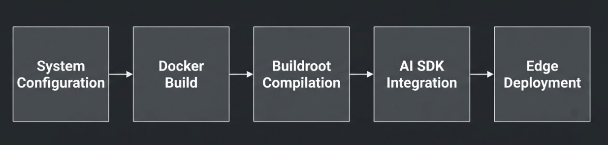
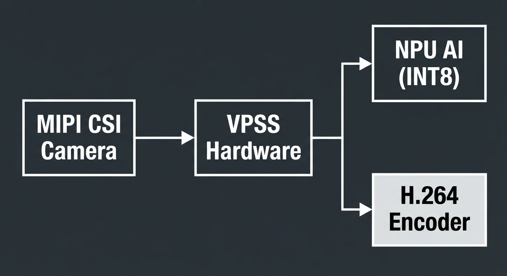
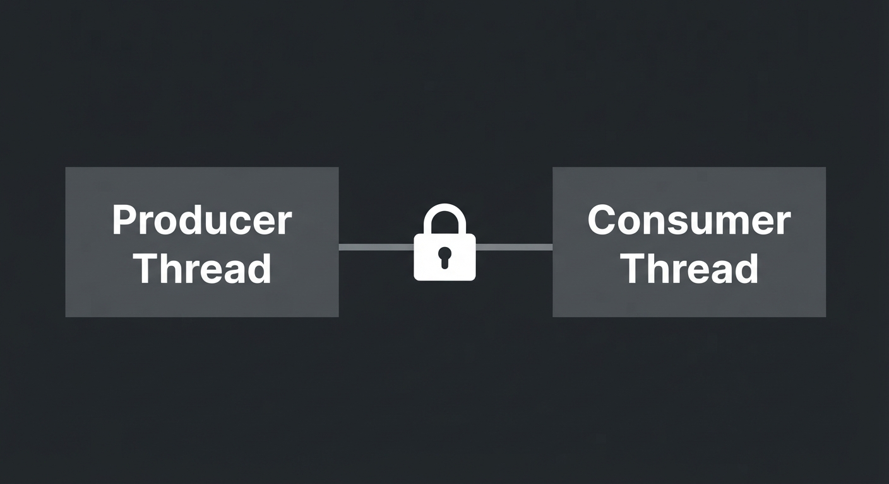
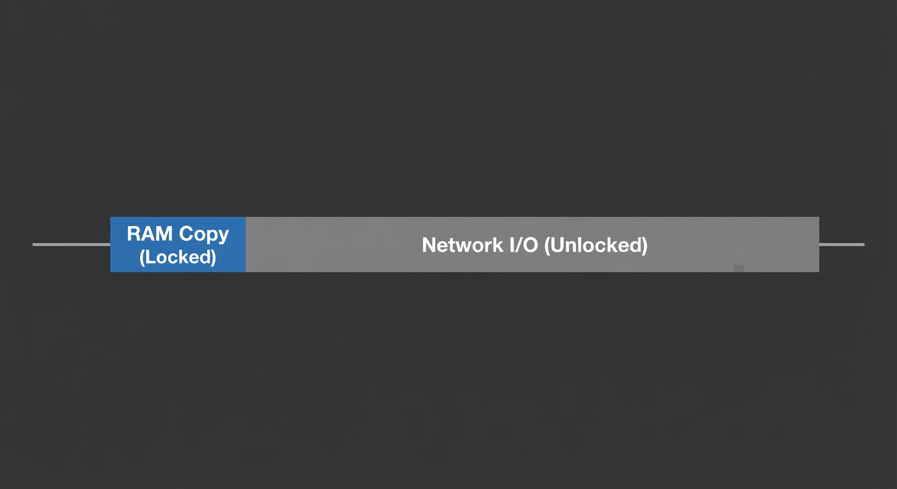

# LicheeRV Nano (SG2002) — Buildroot & Edge AI

**Undergraduate Thesis | Universidad Nacional de Colombia — Bogotá Campus**

*Implementation and Optimization of a YOLO Model on the LicheeRV Nano (SG2002) Embedded Platform for Object Detection with Replicable Documentation in Educational Environments.*

| Academic Information | Details | 
| ----- | ----- | 
| **Author** | Jesús Antonio López Trigozo | 
| **Institution** | Universidad Nacional de Colombia | 
| **Campus** | Bogotá | 
| **Faculty** | Faculty of Engineering | 
| **Advisor** | Carlos Iván Camargo Bareño | 
| **Status** | 🟡 In Progress | 

## Table of Contents

- [01. Project Overview](#01-project-overview)
- [02. Hardware Platform](#02-hardware-platform)
- [03. Development Environment Setup](#03-development-environment-setup)
- [04. Base Dependencies & Software Setup](#04-base-dependencies--software-setup)
- [05. System Compilation & Application Build](#05-system-compilation--application-build)
- [06. System Image Deployment](#06-system-image-deployment)
- [07. Current Development Scope](#07-current-development-scope)
- [08. Software Architecture & Thermal/Performance Optimization](#08-software-architecture--thermalperformance-optimization)
  - [8.1. Source File Responsibilities](#81-source-file-responsibilities)
  - [8.2. Core Optimization Strategies for Low CPU Usage](#82-core-optimization-strategies-for-low-cpu-usage)
  - [8.3. Deep Dive: Technical Justifications & Code Philosophy](#83-deep-dive-technical-justifications--code-philosophy)
- [09. References & Repositories](#09-references--repositories)

---

## 01. Project Overview

This project focuses on preparing a customized embedded Linux environment for **YOLO-based object detection** on the LicheeRV Nano, powered by the SG2002 SoC.

The current work covers system configuration, image compilation, development tools, network connectivity, and the software environment required for AI deployment on resource-constrained hardware.

**Project objectives**

- Customize and compile a Buildroot-based Linux image.
- Reduce unnecessary software and system overhead.
- Configure network connectivity and remote access.
- Prepare the CVI TDL SDK for application development.
- Integrate CivetWeb for HTTP streaming.
- Document the workflow for reproducibility in educational environments.



---

## 02. Hardware Platform

### LicheeRV Nano — SG2002

| Component | Specification |
|---|---|
| **SoC** | SOPHGO SG2002 |
| **Main core** | 1 GHz RISC-V C906 / ARM Cortex-A53 (selectable) |
| **Secondary core** | 700 MHz RISC-V C906 |
| **Low-power core** | 8051, 25–300 MHz |
| **Memory** | 2 Gbit (256 MB) DDR3 |
| **AI accelerator** | Integrated NPU — 1 TOPS INT8, BF16 support |
| **Storage** | TF card / SD NAND |
| **Video output** | 2-lane MIPI DSI, 31-pin interface |
| **Camera input** | 4-lane MIPI CSI, 22-pin interface |
| **Audio** | Onboard amplifier and analog microphone |
| **Wired network** | 100 Mbps Ethernet on E and WE variants |
| **Wireless network** | Dual-band Wi-Fi 6 and Bluetooth 5.4 on W and WE variants |
| **USB** | 1 × USB 2.0 OTG Type-C |
| **Expansion** | 2 × 14-pin, 2.54 mm headers |

### Board Variants

| Variant | Ethernet | Wi-Fi 6 | Bluetooth |
|---|---|---|---|
| **LicheeRV-Nano-B** | No | No | No |
| **LicheeRV-Nano-E** | Yes | No | No |
| **LicheeRV-Nano-W** | No | Yes | Yes |
| **LicheeRV-Nano-WE** | Yes | Yes | Yes |

### Hardware Diagrams & Visual References

| Target Board & Camera Setup | Pinout Diagram |
|---|---|
|  |  |

| Board Variants & Physical Layout |
|---|
|  |

| SG2002 Subsystem Block Diagram | SG2002 System Architecture |
|---|---|
|  |  |


---

## 03. Development Environment Setup

The build environment uses Docker to isolate dependencies and provide a consistent workspace for compiling the system.

### 3.1. Host Prerequisites & Docker Installation

To avoid permission conflicts during rootfs generation and container mounting, switch to superuser privileges (`root`) and navigate to its home directory before starting:

```bash
sudo su
cd /root
```

Install `curl` and deploy Docker on the host system using the official installation script:

```bash
apt update && apt install curl -y && curl -fsSL https://get.docker.com | sh
```

### 3.2. Clone the Build Environment

Run these commands on the **host machine** to download the source code and build the Docker image:

```bash
git clone https://github.com/sipeed/LicheeRV-Nano-Build --depth=1
cd LicheeRV-Nano-Build
git clone https://github.com/sophgo/host-tools --depth=1
cd host/ubuntu
docker build -t licheervnano-build-ubuntu .
```

### 3.3. Start the Docker Container

Run this command on the host machine:

```bash
docker run -v /root/LicheeRV-Nano-Build/:/workspace -it licheervnano-build-ubuntu /bin/bash
```


---

## 04. Base Dependencies & Software Setup

### 4.1. Clone CVI TDL SDK

Inside the container's `/workspace` directory:

```bash
cd /workspace
git clone https://github.com/milkv-duo/cvitek-tdl-sdk-sg200x.git --depth=1
```

### 4.2. Clone CivetWeb Repository

Clone version `v1.15` of CivetWeb into the workspace directory:

```bash
cd /workspace
git clone --branch v1.15 --depth=1 https://github.com/civetweb/civetweb.git
```

---

## 05. System Compilation & Application Build

### 5.1. Configure Buildroot Environment

Execute the following commands **inside the container**:

```bash
cd /workspace
source build/cvisetup.sh
defconfig sg2002_licheervnano_sd
git config --global --add safe.directory /workspace
```

### 5.2. Build Base System Image (build_all)

Trigger the primary base build process **before** placing custom application code:

```bash
cd /workspace
build_all
```


### 5.3. Cross-Compile and Install CivetWeb Library

```bash
cd /workspace/civetweb && make WITH_CPP=0 WITH_LUA=0 WITH_IPV6=1 COMS_CFLAGS="-O2" CC=/workspace/host-tools/gcc/riscv64-linux-musl-x86_64/bin/riscv64-unknown-linux-musl-gcc AR=/workspace/host-tools/gcc/riscv64-linux-musl-x86_64/bin/riscv64-unknown-linux-musl-ar lib && cp libcivetweb.a /workspace/buildroot/output/host/riscv64-buildroot-linux-musl/sysroot/usr/lib/ && cp include/civetweb.h /workspace/buildroot/output/host/riscv64-buildroot-linux-musl/sysroot/usr/include/
```

### 5.4. Deploy Application & Helper Scripts

```bash
git clone https://github.com/m0nkeyh4ck/licheerv-nano-sg2002-yolo-streaming /tmp/repo
mv /tmp/repo/http_streamer_tdl /workspace/middleware/v2/sample/
cp /tmp/repo/*.sh /workspace/ 2>/dev/null || true
rm -rf /tmp/repo
cd /workspace/middleware/v2/sample/http_streamer_tdl
make clean
make
```

### 5.5. Download YOLOv8 CVIMODEL Repository

```bash
cd /workspace
git clone https://github.com/zwyzwm/YOLOv8-Object-Detection.git
```

---

## 06. System Image Deployment

### 6.1. Host Dependency Collection (collect_libraries.sh)

Run the script from your **host machine**:

```bash
cd /root/LicheeRV-Nano-Build
chmod +x collect_libraries.sh
./collect_libraries.sh
```

### 6.2. Flash Image, Stage Assets & Automated Wi-Fi Setup (flash_sd.sh)

Open and edit the script on the host machine:

```bash
nano /root/LicheeRV-Nano-Build/flash_sd.sh
```

Execute:

```bash
cd /root/LicheeRV-Nano-Build
chmod +x flash_sd.sh
./flash_sd.sh
```

### 6.3. Identify the Board on the Network

```bash
sudo nmap -sV -p 22 192.168.1.0/24
```

### 6.4. Connect Through SSH

```bash
ssh root@<BOARD_IP_ADDRESS>
```

### 6.5. Run Streaming Application

```bash
cd /root
./http_streamer_tdl yolov8n_cv181x_int8_sym.cvimodel
```


---

## 07. Current Development Scope

The repository documents the setup and configuration of the embedded Linux environment and the supporting software required for development on the SG2002 platform.

---

## 08. Software Architecture & Thermal/Performance Optimization

The streaming application (`http_streamer_tdl`) is engineered specifically for resource-constrained SoC environments (SOPHGO SG2002 / CV181X). High performance, stable FPS, low CPU utilization, and minimal thermal dissipation are achieved through strict C-level design pattern optimizations.

### 8.1. Source File Responsibilities

| System Architecture Flowchart |
|---|
|  |

| Module (`.c` / `.h`) | Primary Responsibility | Optimization Focus |
|---|---|---|
| `http_streamer_tdl` | Main entry point, signal handling, SDK hardware binding, thread lifecycle. | Clean subsystem tear-down and memory release. |
| `sensor_config` | Sensor initialization (`sensor_cfg.ini` parsing) and format negotiation. | Dynamic resolution setup matching hardware capability. |
| `vb_pool` | Allocation of hardware Video Buffer (VB) pools in DDR memory. | Zero-copy ISP/VPSS hardware buffer reuse across channels. |
| `vi_init` | Video Input (VI) pipeline setup for MIPI CSI capture. | Direct hardware DMA streaming from sensor to DDR. |
| `vpss_init` | Video Processing SubSystem configuration (scaling, pixel format conversion). | Dual-channel hardware scaling (1080p for stream, 640x480 for NPU). |
| `venc_handler` | H.264 encoding thread (`VENC`), NPU inference thread (`TDL`), and ring buffer. | Reusable memory ring buffer and NPU label overlay. |
| `fmp4_init_segment` | ISO/IEC 14496-12 MP4 container box builder (`ftyp`, `moov`, `moof`, `mdat`). | In-memory fast NAL unit Annex-B to AVCC conversion. |
| `mse_stream` | Media Source Extensions (MSE) HTTP chunked video streaming server handler. | Passive thread synchronization and static copy buffering. |
| `web_handler` | CivetWeb HTTP routes (`/`, `/stream`, `/stats`), HTML/JS web player interface. | Network socket I/O decoupled from mutex lock scopes. |

---

### 8.2. Core Optimization Strategies for Low CPU Usage

#### 1. Hardware Pipeline Offloading (Zero-CPU Video/AI Pipeline)
Instead of processing frames in software via CPU routines:
- **MIPI CSI Camera Capture (`VI`)** streams frames via DMA directly into hardware memory pools (`VB Pool`).
- **Video Process SubSystem (`VPSS`)** splits the capture into two hardware streams: Channel 0 scales frames to 1080p for encoding, while Channel 1 scales frames to 640x480 for NPU inference.
- **NPU Acceleration (`TPU / CVI_TDL`)** handles INT8 YOLOv8 tensor operations on dedicated silicon, leaving the RISC-V host CPU idling.
- **Hardware Encoder (`VENC`)** compresses raw NV21 frames directly into H.264 streams in real-time.



#### 2. Zero Per-Frame Heap Allocation (Persistent Dynamic Buffering)
Executing `malloc()` and `free()` inside 30 FPS high-frequency loops causes kernel heap fragmentation, system calls overhead, thermal throttling, and CPU spikes.

To eliminate this, `venc_handler.c` and `mse_stream.c` utilize **persistent capacity-expanding buffers**. Buffers expand only when encountering larger frame sizes and reuse memory indefinitely.

#### 3. Passive Thread Synchronization (`pthread_cond_t` vs Polling)
Polling loops with `usleep()` consume CPU cycles during sleep-wake transitions and introduce jitter. The streaming handlers utilize POSIX condition variables (`pthread_cond_timedwait`).

#### 4. Mutex Decoupling from Network Socket I/O
Performing slow blocking socket writes (`mg_write`) inside critical section locks causes thread starvation and blocks video capture pipelines. In `web_handler.c`, frame data is copied locally inside a fast mutex lock, and the lock is **released immediately prior to network transmission**.

---

### 8.3. Deep Dive: Technical Justifications & Code Philosophy

This section serves as a comprehensive textbook-level explanation of **why** specific libraries, code structures, and paradigms were chosen over conventional alternatives. Developing for an embedded RISC-V SoC with 256MB of shared DDR memory requires abandoning standard desktop-level programming practices.

#### 8.3.1. The Justification for fMP4 and MSE over MJPEG or WebSockets
*Referencing: `fmp4_init_segment.c` and `mse_stream.c`*

In many embedded IP cameras, **MJPEG (Motion JPEG)** is the default streaming protocol because it is trivial to implement: the server simply takes an array of JPEG images and sends them over HTTP in a multipart stream. 
**Why we rejected MJPEG:**
1. **Bandwidth Annihilation:** A 1080p JPEG image can be 200KB-500KB. At 30 FPS, MJPEG requires between 48 Mbps to 120 Mbps of network bandwidth. This saturates the LicheeRV Nano's Wi-Fi module immediately, causing severe frame drops.
2. **Missing NPU Advantages:** MJPEG encodes each frame from scratch, completely ignoring temporal redundancy (the fact that backgrounds don't change).

**Why we rejected WebSockets with Raw H.264:**
While we use the hardware `VENC` to generate H.264 NALUs (Network Abstraction Layer Units), sending raw NALUs over WebSockets requires the browser client to use software decoders (like Broadway.js) via WebAssembly. Software decoding in the browser is CPU-intensive for the client and introduces massive latency.

**The Solution: Media Source Extensions (MSE) with fragmented MP4 (fMP4):**
By packing the raw H.264 NALUs into an MP4 container on the fly (`fmp4_init_segment.c`), we allow the receiving web browser to use its native hardware video decoder via the HTML5 `<video>` tag. 
*   **The Initialization Segment (`ftyp` + `moov`):** Created exactly once when a client connects. It tells the browser the resolution (1920x1080), framerate, and provides the SPS/PPS metadata required by H.264.
*   **The Fragments (`moof` + `mdat`):** Each time the `VENC` thread provides a new frame, we wrap it in a fragment. 
*   **Zero-Overhead Parsing:** We built a custom Annex-B to AVCC parser (`annexb_copy_cb`). Instead of using large libraries like FFmpeg (which would bloat our binary and consume RAM), we parse the 4-byte `0x00000001` NALU delimiters using a raw pointer slide in C. 


#### 8.3.2. Dynamic Ring Buffer Architecture
*Referencing: `venc_handler.c` (`g_frame_ring`)*

The system must handle multiple concurrent HTTP clients without duplicating memory. 

**The naive approach (which we avoided):**
Allocating a new buffer `malloc(frame_size)` every time the hardware generates a frame, appending it to a linked list, and freeing it after clients read it. In an embedded system, this causes memory fragmentation. The Linux OOM (Out-of-Memory) killer would eventually terminate our process.

**Our Architecture: Pre-allocated Circular Ring Buffer**
We declare an array of structs `g_frame_ring[BUFFER_SIZE]`.
```c
// Dynamic expansion logic in venc_handler.c
if (g_frame_ring[idx].capacity < total_size) {
    uint8_t *new_ptr = realloc(g_frame_ring[idx].data, total_size + 16384);
    // ...
}
```
*   **Why `+ 16384`?** We pad the reallocation. I-frames (Keyframes) are significantly larger than P-frames. By adding a 16KB padding during `realloc`, we ensure that future I-frames fit without triggering another costly system call. Over the first few seconds of streaming, the buffer capacities stabilize to the maximum possible frame size, and `realloc` is **never called again**. Memory footprint remains strictly flat.


#### 8.3.3. Threading Synchronization: Mutex vs Spinlocks vs Condition Variables
*Referencing: `http_streamer_tdl.c` and `mse_stream.c`*

We have a classic Producer-Consumer problem:
*   **Producer:** `run_venc_thread` (Hardware encoder feeding H.264 frames).
*   **Consumer:** `handler_stream_mse` (HTTP clients requesting data).

**Why not Polling?**
```c
// BAD CODE EXAMPLE - REJECTED
while(!new_frame) {
    usleep(1000); // Sleeps for 1ms
}
```
`usleep` forces a context switch. Waking up the thread 1000 times a second to check a boolean flag completely saturates one CPU core, generating severe heat (thermal throttling).

**The implementation used: `pthread_cond_timedwait`**
```c
struct timespec ts;
clock_gettime(CLOCK_REALTIME, &ts);
ts.tv_nsec += 50000000; // 50ms timeout
pthread_cond_timedwait(&g_frame_cond, &g_frame_lock, &ts);
```
1.  The HTTP thread locks the mutex, checks if a frame is available.
2.  If not, it calls `pthread_cond_timedwait`. This **atomically unlocks the mutex and puts the thread to sleep**. The CPU usage drops instantly to 0%.
3.  When the `VENC` thread finishes copying a frame, it calls `pthread_cond_broadcast(&g_frame_cond)`.
4.  The kernel instantly wakes up *all* sleeping HTTP threads, relocks the mutex, and serves the frame with sub-millisecond latency. 
5.  *Why `timedwait` instead of infinite wait?* The 50ms timeout acts as a dead-man's switch. If the camera hardware freezes, the HTTP thread will wake up, verify the exit flag (`g_bExit`), and close gracefully instead of becoming a zombie thread.



#### 8.3.4. Overcoming Network Head-of-Line Blocking
In embedded systems with cheap Wi-Fi modules, TCP transmission can stall due to packet loss or interference. 

If we send data to the network *while* holding the global frame mutex:
```c
// BAD PATTERN
pthread_mutex_lock(&g_frame_lock);
mg_write(conn, data, size); // Blocks for 200ms if Wi-Fi is bad
pthread_mutex_unlock(&g_frame_lock);
```
This implies the `VENC` hardware thread cannot write new frames into the ring buffer because the mutex is held by a struggling network thread. The video pipeline would crash.

**Our Lock-Free I/O Pattern:**
```c
// GOOD PATTERN (Implemented in mse_stream.c)
pthread_mutex_lock(&g_frame_lock);
// 1. FAST MEMORY COPY (Microseconds)
memcpy(frame_copy, g_frame_ring[next].data, frame_size);
pthread_mutex_unlock(&g_frame_lock); // UNLOCK BEFORE I/O

// 2. SLOW NETWORK WRITE (Milliseconds)
send_chunk(conn, frag.data, frag.size);
```
By allocating a private `frame_copy` buffer per client, we enter the critical section just long enough to copy the bytes from RAM to RAM. Once unlocked, `mg_write` (CivetWeb's socket sender) can take as long as it needs over a bad Wi-Fi connection without stalling the core AI or video hardware.



#### 8.3.5. Why CivetWeb?
Instead of building an HTTP server from scratch or using bulky solutions like Nginx or Node.js (which cannot run directly embedded inside our C memory space), we integrated **CivetWeb**.
*   **Statically Linked:** `libcivetweb.a` is compiled directly into our binary. No external daemon is required.
*   **Pthreads Integration:** It manages its own thread pool for incoming HTTP requests.
*   **Raw Socket Access:** It provides `mg_write` and chunked transfer encoding (`Transfer-Encoding: chunked`), which is strictly required for endless MSE video streams.

---

## 09. References & Repositories

1. **Sipeed LicheeRV Nano Official Documentation:**  
   [Sipeed LicheeRV Nano Wiki - Overview](https://wiki.sipeed.com/hardware/en/lichee/RV_Nano/1_intro.html)

2. **Habr Technical Article — LicheeRV Nano Testing & Development Workflow:**  
   [LicheeRV Nano Development, Integration, and Hardware Tests](https://habr.com/ru/articles/880230/)

3. **Sipeed LicheeRV-Nano-Build Repository:**  
   [Sipeed LicheeRV-Nano-Build GitHub](https://github.com/sipeed/LicheeRV-Nano-Build)

4. **SOPHGO Host Tools Repository:**  
   [SOPHGO Host Tools GitHub](https://github.com/sophgo/host-tools)

5. **CVI TDL SDK for SG200X Repository:**  
   [Milk-V Duo CVITEK TDL SDK GitHub](https://github.com/milkv-duo/cvitek-tdl-sdk-sg200x)

6. **CivetWeb Embedded HTTP Server Repository:**  
   [CivetWeb GitHub](https://github.com/civetweb/civetweb)

---

**Universidad Nacional de Colombia · Bogotá Campus**  
*Undergraduate Thesis — Embedded Systems and Edge AI*
